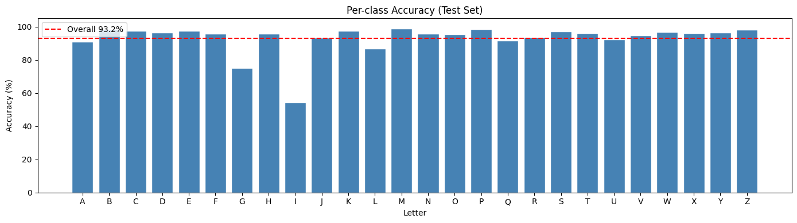
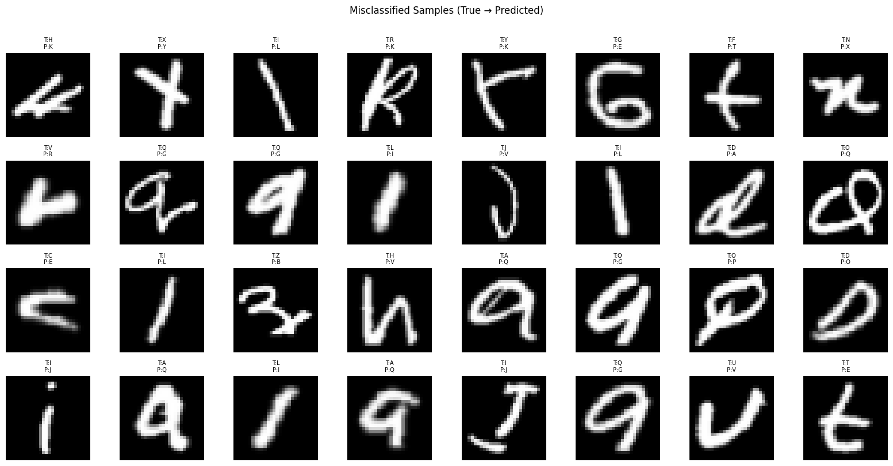
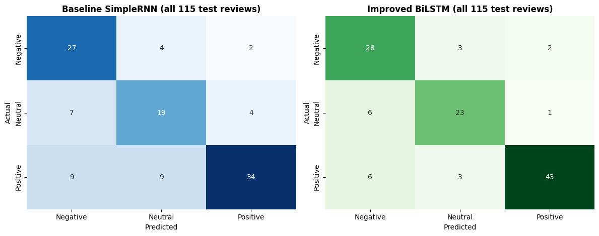

# Handwriting and Sentiment Models

Two deep learning projects in TensorFlow/Keras: a **CNN** that reads handwritten letters, and an **RNN** that classifies the sentiment of short pizza reviews written in English and Malay.

| Project | Notebook | Result |
|---|---|---|
| Handwritten letter recognition (CNN) | [`handwriting_cnn.ipynb`](handwriting_cnn.ipynb) | **93.2%** test accuracy across 26 letters, with 85% fewer parameters than the baseline |
| Pizza review sentiment (RNN) | [`review_sentiment_rnn.ipynb`](review_sentiment_rnn.ipynb) | **85.4%** average accuracy (5 seeds) on 3 classes across English and Malay reviews, against 73.2% for an English-only baseline |

## 1. Handwritten letter recognition (CNN)

### The problem

The EMNIST Letters dataset has 88,800 handwritten letters as 28 × 28 greyscale images, evenly spread across A–Z. The goal is to classify each image as one of the 26 letters.

### Approach

1. **Data checks and preparation:** removed rows with invalid labels, scaled pixels to 0–1, reshaped them into images (fixing EMNIST's transposed storage), and made a stratified 70/15/15 split.
2. **Baseline CNN:** two convolution blocks, then `Flatten → Dense(128)`. That head alone holds 401,536 of the model's 423,706 parameters.
3. **Improved CNN:** batch normalisation, a second convolution in block 2, `GlobalAveragePooling2D` in place of `Flatten`, more dropout and `ReduceLROnPlateau`. That's 62,490 parameters in total.
4. **Augmentation experiment:** trained the improved model with and without random rotation, zoom, shift and shear, and picked the better run on validation accuracy.
5. **Error analysis:** per-letter metrics, a confusion matrix, prediction confidence and the first layer's feature maps.

### Results

| Model | Parameters | Test accuracy | Test loss |
|---|---|---|---|
| Baseline CNN | 423,706 | 93.04% | 0.2174 |
| **Improved CNN (with augmentation)** | **62,490** | **93.18%** | **0.2006** |

The accuracy difference is small: one training run each, and 0.14 points is within run-to-run noise. The real result is that the improved model matches the baseline with **85% fewer parameters**, and the change that did it was replacing `Flatten` with global average pooling. Augmentation added only 0.06 points of validation accuracy.

93% overall hides one weak letter:



**I** is recognised only 54% of the time, and most of the misses are predicted as **L** (211 test images). **G** is often read as **Q**. A lot of these mistakes are hard for a person too:



The model is also much less confident when it's wrong: 67% average confidence on errors against 95% on correct predictions. That makes confidence a useful signal for sending uncertain letters to a human.

## 2. Pizza review sentiment (RNN)

### The problem

The dataset has 902 short reviews of fusion pizzas (satay, sambal and mayo toppings), each with a 0–10 score. It's messy: scores range from −42 to 1,010 or are text like "good", there are duplicates and conflicting labels, and 45% of the reviews are in Malay. Scores are grouped into **negative (≤ 4), neutral (4–6) and positive (> 6)**.

### Approach

1. **Cleaning:** removed invalid scores, empty reviews, exact duplicates and reviews whose duplicates had different labels, leaving 766 English and Malay reviews.
2. **One fair split:** a single train/validation/test split, stratified by sentiment and language, shared by both models. Tokenizers are fitted on training text only.
3. **Baseline:** a `SimpleRNN` (4,851 parameters) trained on the English training reviews.
4. **Improved model** (48,515 parameters):
   - **More data:** the Malay reviews, translated to English and lemmatised, instead of being dropped
   - **Augmentation:** synonym replacement and random insertion (EDA, Wei & Zou 2019), growing the training set from 553 to 981 rows
   - **Model:** a bidirectional LSTM with dropout, L2 regularisation and class weights
   - **Tuning:** Keras Tuner Hyperband searched embedding size, LSTM units and learning rate
5. **Evaluation:** both models scored on the same test reviews, retrained with 5 random seeds.

### Results

Average test accuracy over 5 seeds, on the same reviews for both models:

| Test set | Baseline SimpleRNN | Improved BiLSTM |
|---|---|---|
| English test reviews (63) | **90.2% ± 3.6** | 83.8% ± 2.6 |
| All test reviews, Malay translated (115) | 73.2% ± 2.4 | **85.4% ± 2.6** |

The result splits in two:

- **Across all reviews, the BiLSTM is clearly better, in all 5 seeds.** In the seed-42 run, it gets 45 of the 52 translated Malay reviews right, against 26 for the English-only baseline.
- **On English reviews alone, the small baseline wins, in 4 of 5 seeds.** The bigger model's advantage comes from covering the Malay half of the data, not from reading English better.



The remaining errors are mostly lukewarm reviews read as negative (*"satay flavor was present but not very strong"*), negations (*"never disappoints"*) and rare positive words (*"exceptional flavor harmony"*).

### How this project changed

My first version compared the two models on **different test sets** (63 English reviews vs 116 mixed reviews), fitted its tokenizers before splitting, and didn't stratify the split. It reported the BiLSTM as 2 points better overall. After fixing all three, the honest picture is the one above. I also learned how fragile single runs are here: a change as small as British vs American spelling in the translations moved one model's accuracy by about 10 points, which is why the results are averaged over seeds.

## What I learned

- A smaller, well-designed model can match a much bigger one. Global average pooling removed about 400,000 parameters at no cost in accuracy.
- Overall accuracy can hide a class that fails: 93% overall, but only 54% for the letter I.
- Data coverage can matter more than architecture. Translating the Malay reviews is what made the bigger model win.
- A comparison is only fair on the same test set, and on small data it needs several runs. Fixing both reversed part of my original conclusion.

## What I'd improve

- Run an ablation on the sentiment model (translation, augmentation, lemmatisation and architecture, one at a time) to see why the BiLSTM does worse on English reviews.
- Try a multilingual pre-trained model that reads Malay directly, with no translation step.
- Repeat the CNN runs with several random seeds too, since differences of 0.1 points are noise.
- Try targeted augmentation or focal loss for the hard letters (I and G).

## Run it

```bash
pip install -r requirements.txt
jupyter notebook
```

The notebooks keep their outputs, so you can read every chart and result without running them. Both use TensorFlow 2.10. The CNN was trained on a GPU; the sentiment notebook runs on a CPU in about 4 minutes and gives the same numbers on every run.

## Data

- `data/Pizza_reviews.csv`: 902 pizza reviews in English and Malay, with a score and a language label.
- `data/malay_translations.csv`: English translations of the 354 unique Malay reviews, made with an AI model (Claude) and saved, so the notebook needs no translation service. They use American spelling, to match the English reviews.
- The EMNIST CSV (about 200 MB) is too large for GitHub, so it isn't included. EMNIST Letters comes from [NIST](https://www.nist.gov/itl/products-and-services/emnist-dataset) (Cohen et al., 2017), and a CSV version is available on Kaggle. Save it as `data/emnist-letters.csv`. The file used here also had 10,240 rows with invalid labels (−1, −2), which the notebook removes, so results from another copy may differ slightly.
